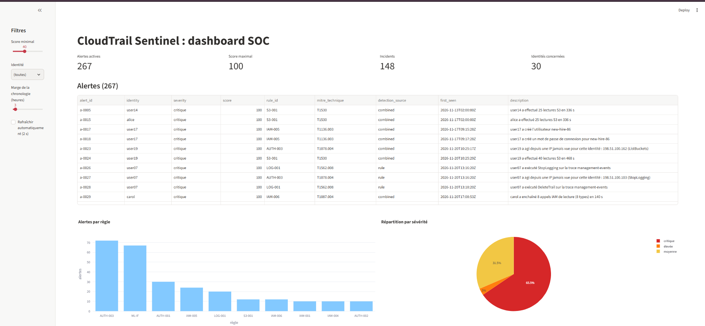
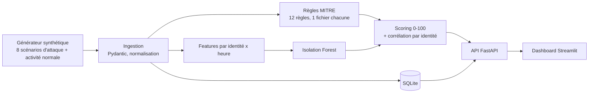

# CloudTrail Sentinel

Détection d'anomalies sur les logs **AWS CloudTrail** : 12 règles heuristiques mappées sur
**MITRE ATT&CK**, **Isolation Forest**, score de risque 0–100, corrélation par identité,
API REST et dashboard SOC. 100 % gratuit, sans compte AWS.

> Projet de fin d'année (PFA), sécurité cloud, EMSI, 2026/2027
> Auteurs : Dounia BARRI et Aymen EL OUAHBI · Encadrant : M. Moumen Idriss



## Pourquoi

Sur AWS, voler une identité (utilisateur IAM, rôle, clé d'accès) suffit souvent pour obtenir
des privilèges étendus sans toucher à un serveur. CloudTrail enregistre toutes ces actions,
mais ses journaux sont volumineux et verbeux : une création d'utilisateur ou une connexion
depuis une IP inhabituelle se noie dans l'activité légitime. Sentinel repère ces séquences,
les classe par un score de risque et reconstitue la chronologie d'une identité.

## Démarrage en une commande

Prérequis : Docker Desktop.

```bash
docker compose up --build
```

| Service | Adresse |
|---|---|
| Dashboard SOC | http://localhost:8501 |
| API (documentation interactive) | http://localhost:8000/docs |

Au premier lancement, un service `bootstrap` génère les logs synthétiques, remplit SQLite et
calcule les alertes (quelques secondes). Démonstration en quasi temps réel, dans un second
terminal : `docker compose --profile demo up replay`. Arrêt : `docker compose down -v`.

## Sans Docker

```bash
python -m venv .venv
source .venv/bin/activate          # Windows : .venv\Scripts\activate
pip install -r requirements.txt
python scripts/bootstrap.py        # données, base SQLite, alertes
uvicorn src.api.main:app           # API sur :8000
streamlit run src/dashboard/app.py # dashboard sur :8501 (dans un autre terminal)
python -m src.api.replay           # rejeu des alertes avec délai simulé (optionnel)
```

## Architecture



| Couche | Modules |
|---|---|
| Données | `scripts/generate_data.py`, `tests/fixtures/` |
| Ingestion et stockage | `src/ingestion/`, `src/storage/` |
| Détection | `src/detection/rules/` (catalogue : [docs/detections.md](docs/detections.md)), `src/detection/ml/` |
| Scoring et évaluation | `src/scoring/`, `src/evaluation/` |
| Exposition | `src/api/`, `src/dashboard/` |

Contrats d'interface (schéma de la base, format d'alerte, routes) : [docs/contracts.md](docs/contracts.md).

## Résultats

Jeu de test : 1 889 fenêtres (identité x heure) dont 57 d'attaque, séparées **par identité**.
Le scénario `persistence_access_key` est exclu de l'entraînement du ML. Graine fixée.

| Approche | Precision | Recall | F1 | Faux positifs |
|---|---|---|---|---|
| Règles seules | 0,90 | 0,98 | 0,94 | 0,3 % |
| Isolation Forest seul | 0,25 | 0,49 | 0,33 | 4,6 % |
| Règles OU Isolation Forest | 0,40 | 1,00 | 0,58 | 4,6 % |
| Random Forest supervisé (référence) | 0,98 | 0,97 | 0,97 | 0,1 % |
| Score de risque >= 70 (règles + ML plafonné) | 0,89 | 0,82 | 0,85 | 0,3 % |

À retenir :

- Les règles détectent 100 % des fenêtres des 7 scénarios du cahier des charges. Le 8e scénario,
  le **minage de cryptomonnaie**, n'a pas de règle dédiée : les règles n'en attrapent que 83 %
  (indirectement), et le ML apporte la fenêtre manquante, au prix de faux positifs.
- L'Isolation Forest repère les attaques de volume (reconnaissance, exfiltration S3) et
  manque les actions discrètes (arrêt de la journalisation, connexion sans MFA). Il ne détecte
  que 30 % du scénario non vu.
- Pour ne pas noyer les règles, une alerte ML seule est plafonnée à un score de 59.

Détails et matrices de confusion : [docs/evaluation.md](docs/evaluation.md).

**Réserve importante** : les logs et les règles ont été conçus ensemble, donc les chiffres des
règles sont optimistes. Les données sont synthétiques et le test ne contient que 57 fenêtres
d'attaque.

### Validation sur logs réels (flaws.cloud)

Échantillon de 50 000 événements réels et anonymisés (les 2 500 premiers de chacun des 20 fichiers
du jeu public de Summit Route, 2017-2020). Ces logs ne sont **pas étiquetés** : il s'agit d'un
contrôle de robustesse, pas d'une mesure de precision ni de recall ([docs/public_data.md](docs/public_data.md)).

- 100 % des événements sont acceptés par l'ingestion (0 rejeté).
- Les règles `IAM-002`, `IAM-003` et `AUTH-004`, sans scénario dans le générateur, se déclenchent
  sur ces logs : elles sont donc exercées sur des données qui ne sont pas les nôtres.
- `AUTH-004` (activité du compte root) produit 2 472 des 2 684 alertes, soit 92 % : il faudrait
  regrouper ces alertes pour ne pas noyer l'analyste.
- 72 % des événements sont des `RunInstances`, et aucune règle ne couvre le lancement massif
  d'instances (minage, technique T1496) : piste d'amélioration.

## Reproduire les résultats

```bash
python scripts/generate_data.py --extended --seed 7 --attack-repeats 10 --out data/generated_ml
python -m src.detection.ml.features --out data/generated_ml/features.csv
python -m src.evaluation.compare --unseen persistence_access_key --out docs/evaluation.md
python -m src.scoring.scoring --unseen persistence_access_key --ml-threshold 85
# Contrôle sur logs réels (télécharge 250 Mo dans data/public/, ignoré par Git)
python scripts/download_public_data.py
python -m src.evaluation.public_check --out docs/public_data.md
```

## Qualité et sécurité

- `pytest` : tests unitaires, un cas positif et un cas négatif par règle, test de bout en bout
  (ingestion, règles, scoring, API, rejeu).
- `ruff` en pré-commit et en CI ; GitHub Actions lance les tests, l'audit du dépôt, gitleaks
  et la construction Docker.
- `python scripts/audit_repo.py` vérifie qu'aucun secret, compte AWS réel ou IP réelle n'est
  versionné : seules les valeurs fictives sont admises (compte `123456789012`, IP
  `203.0.113.x`, `198.51.100.x`, `192.0.2.x`).
- Projet exclusivement défensif : les scénarios d'attaque ne servent qu'à produire des logs de test.

## Limites

- Données synthétiques : un modèle simplifié de la réalité, résultats à interpréter avec prudence.
- Les logs publics de flaws.cloud ne sont pas étiquetés : ils servent à contrôler la robustesse,
  pas à mesurer precision et recall. Ils sont téléchargés à la demande et jamais redistribués.
- Une seule graine d'évaluation, pas de validation croisée.
- Pas d'ingestion en continu depuis un compte AWS réel ni de remédiation automatique (hors périmètre).
- L'agent d'investigation LLM (optionnel) n'est pas implémenté.

## Perspectives

Autres sources de logs (GuardDuty, VPC Flow Logs), autres clouds, ingestion en continu,
agent d'investigation local (Ollama, LangGraph) avec citation des événements.

## Licence

MIT, voir [LICENSE](LICENSE).
